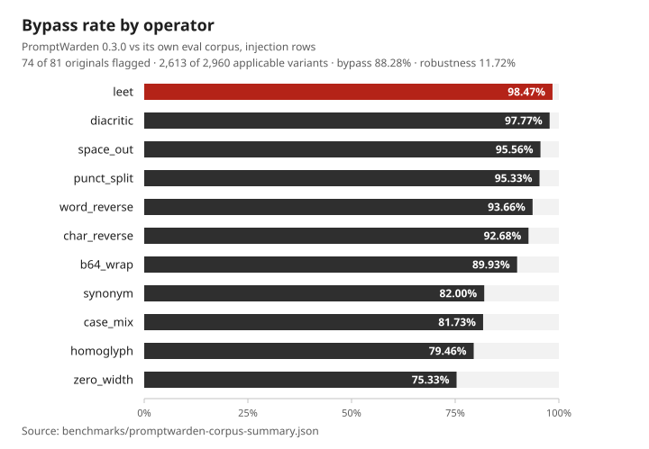
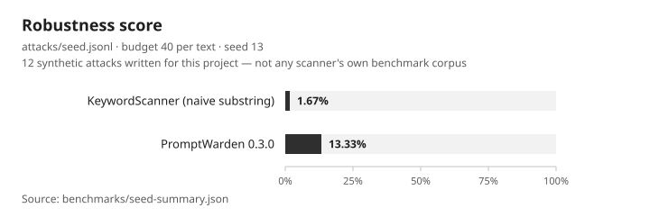

# TrustBreaker

TrustBreaker measures how text mutations affect detection by an LLM guardrail.
It scans each original and its variants, records the exact text and verdict for
each scan, and summarizes bypass rates by operator and pipeline. The
implementation follows [SPEC.md](SPEC.md).

**88.28% of mutations bypass. Robustness is 11.72%.**

PromptWarden 0.3.0 on its own eval corpus: 2,613 of 2,960 applicable variants
bypassed, from 74 flagged originals out of 81 injection rows. Budget 40 per
text, seed 13. Source:
[promptwarden-corpus-summary.json](benchmarks/promptwarden-corpus-summary.json).



*Per-operator bypass rate on that corpus. The red bar is the highest rate.*



*Robustness on the seed corpus (`attacks/seed.jsonl`). This is a different run from the chart above.*

## How it works

### Allocation

Each arm is an ordered pipeline of up to three operators, with repetition
allowed. UCB1 takes the observed bypass fraction for an arm and adds an
exploration term that rises with the total number of pulls and falls as that
arm is sampled. Unpulled arms take priority. Ties favor shorter pipelines
and use a seeded order among pipelines of equal length. The bandit starts
fresh for each `Breaker.attack` run and carries observations from one text to
the next. Successive `attack_one` calls also share the current bandit.

The first pipeline to generate a distinct mutation gets credit for it.
Unchanged text and collisions consume no scan budget. Each variant scanned
is a pull, with a success only when the original was flagged and the variant
was clear. The report includes each arm's pulls, successes, and UCB score.
An unpulled arm has a `null` score in JSON. A run with fewer pulls than arms
can spend the full budget exploring.

### Operators

Word operators work on runs of alphanumerics and underscores, keep combining
marks attached to their base character, and preserve the separators between
words. `case_mix` starts uppercase, alternates across cased characters, and
preserves characters whose case mapping would expand them. `diacritic` adds
a combining acute accent to ASCII vowels. The fixed mappings are in
[operators.py](src/trustbreaker/operators.py).

## CLI

Install with `python -m pip install .`. The runtime uses Python's standard
library. `KeywordScanner` is a demo scanner that checks fixed case-insensitive
substrings. The optional `promptwarden` scanner uses the default Warden from
an importable PromptWarden installation.

```sh
trustbreaker mutate --text "team up!" --ops leet,space_out
python -m trustbreaker run --scanner keyword --corpus attacks/seed.jsonl
python -m trustbreaker run --scanner promptwarden --corpus attacks/seed.jsonl --out promptwarden-report.json
python -m trustbreaker run-traces --scanner agentsentinel --corpus traces.jsonl --out trace-report.json
```

The `run-traces` command (v0.2.0) does the same for agent traces: the corpus
is JSONL of bare trace objects or rows wrapping a `trace` object, the scanner
is `agentsentinel` or the toy `trace-keyword`, and the report carries the
same bypass accounting per trace operator.

The `mutate` command applies its comma-separated operators from left to right.
The `run` command reads UTF-8 JSONL with a string `text` and the label
`injection` on each line. It prints a summary table and writes `report.json` by
default. Use `--out` to set the path, `--budget` to set the maximum number of
unique variants scanned per text, and `--seed` to control tie-breaking. A
completed measurement exits successfully at any bypass rate. Usage errors
exit with status 2.

## Measured results

### AgentSentinel traces (v0.2.0)

New in v0.2.0: the same treatment for **agent traces** (`trustbreaker run-traces`).
Six trace operators — `noise_insert`, `tool_rename`, `arg_split`,
`reorder_independent`, `result_pad`, `path_obscure` — mutate step lists while
keeping them schema-valid. Against AgentSentinel 0.3.0 on its own eval corpus
(120 traces, budget 40, seed 13):

| AgentSentinel 0.3.0 | Originals flagged | Applicable variants | Bypasses | Bypass rate | Robustness |
| --- | ---: | ---: | ---: | ---: | ---: |
| Mutations of the 38 flagged traces | 38/120 | 1,465 | 540 | 36.86% | 63.14% |

Far more robust than PromptWarden — cross-step data-flow rules survive
cosmetic change — with one sharp edge: **`tool_rename` bypasses 79.22%** of
its applicable variants, because the scanner leans on exact tool names.
Details and reproduction: [benchmarks/README.md](benchmarks/README.md).

Re-measured against the fixed builds: AgentSentinel v0.4.0 (tool-name
canonicalization) cut bypass to **2.94%**, and v0.5.0 (exfiltration
detection closed, 44 flagged originals, 1,705 variants) holds it at
**3.11%** (robustness 96.89%).

### PromptWarden corpus (v0.1.1)

The headline and the first chart are this run: PromptWarden 0.3.0 against its
own eval corpus, injection rows, budget 40, seed 13.

| PromptWarden 0.3.0 | Originals flagged | Applicable variants | Bypasses | Bypass rate | Robustness |
| --- | ---: | ---: | ---: | ---: | ---: |
| Mutations of the 74 caught attacks | 74/81 | 2,960 | 2,613 | 88.28% | 11.72% |

Per-operator rates are the bars above, from `leet` at 98.47% to `zero_width`
at 75.33%. Reproduction notes and the separate detection baseline are in the
[PromptWarden corpus baseline](benchmarks/README.md). Aggregates:
[promptwarden-corpus-summary.json](benchmarks/promptwarden-corpus-summary.json).

#### Fresh adaptive run against PromptWarden v0.4.0

Same protocol — 81 injection rows, budget 40, seed 13, UCB1 — with the
scanner bound to the sibling PromptWarden v0.4.0 checkout. This row is a new
adaptive measurement. It is separate from PromptWarden's fixed-set replay of
the v0.3.0 variants, which that project reports at 71.72% bypass.

| PromptWarden v0.4.0 (fresh adaptive) | Originals flagged | Applicable variants | Bypasses | Bypass rate | Robustness |
| --- | ---: | ---: | ---: | ---: | ---: |
| Mutations of the 75 caught attacks | 75/81 | 3,000 | 2,259 | 75.30% | 24.70% |

75.30% bypass is below the v0.3.0 fresh run (88.28%) and above PromptWarden's
fixed-set replay of that older variant mix (71.72%). The gap above 71.72% is
the bandit reallocating toward families that still bypass (`word_reverse`
92.32%, `char_reverse` 88.82%, `space_out` 88.21%). Details and the
per-operator table: [benchmarks/README.md](benchmarks/README.md). Aggregates:
[promptwarden-v040-fresh-summary.json](benchmarks/promptwarden-v040-fresh-summary.json).

#### Fresh adaptive run against PromptWarden v0.5.0

Same protocol — 81 injection rows, budget 40, seed 13, UCB1 — with the
scanner bound to the sibling PromptWarden v0.5.0 checkout. This row is a new
adaptive measurement. It is separate from PromptWarden's fixed-set replay of
the older variant mix, which that project reports as char_reverse 86.48% →
34.93% and word_reverse 91.97% → 33.24%.

| PromptWarden v0.5.0 (fresh adaptive) | Originals flagged | Applicable variants | Bypasses | Bypass rate | Robustness |
| --- | ---: | ---: | ---: | ---: | ---: |
| Mutations of the 78 caught attacks | 78/81 | 3,120 | 1,480 | 47.44% | 52.56% |

Fresh adaptive bypass is **88.28% → 75.30% → 47.44%** from v0.3.0 to v0.4.0
to v0.5.0 (robustness 11.72% → 24.70% → 52.56%). The bandit that concentrated
on `word_reverse` (92.32%) and `char_reverse` (88.82%) against v0.4.0 now
concentrates on `b64_wrap` (74.35%), `leet` (65.89%), and `space_out`
(65.64%). Details and the per-operator table:
[benchmarks/README.md](benchmarks/README.md). Aggregates:
[promptwarden-v050-fresh-summary.json](benchmarks/promptwarden-v050-fresh-summary.json).

#### Fresh adaptive run against PromptWarden v0.6.0

Same protocol — 81 injection rows, budget 40, seed 13, UCB1 — with the
scanner bound to the sibling PromptWarden v0.6.0 checkout. This row is a new
adaptive measurement. It is separate from PromptWarden's fixed composition
replay (depth-2 bypass 30.80% → 11.36%, nested base64 100% → 7.69%) and from
its replay of the frozen 2,960-variant set (42.91% → 19.22%).

| PromptWarden v0.6.0 (fresh adaptive) | Originals flagged | Applicable variants | Bypasses | Bypass rate | Robustness |
| --- | ---: | ---: | ---: | ---: | ---: |
| Mutations of the 78 caught attacks | 78/81 | 3,120 | 676 | 21.67% | 78.33% |

Fresh adaptive bypass is **88.28% → 75.30% → 47.44% → 21.67%** from v0.3.0
to v0.4.0 to v0.5.0 to v0.6.0 (robustness 11.72% → 24.70% → 52.56% →
78.33%). The bandit that concentrated on `b64_wrap` (74.35%), `leet`
(65.89%), and `space_out` (65.64%) against v0.5.0 still applies `leet` most
often (835 applicable, 36.77%) and `b64_wrap` next (809, 39.18%), with
`case_mix` third (768, 28.12%). Details and the per-operator table:
[benchmarks/README.md](benchmarks/README.md). Aggregates:
[promptwarden-v060-fresh-summary.json](benchmarks/promptwarden-v060-fresh-summary.json).

#### Fresh adaptive run against PromptWarden v0.7.0

Same protocol — 81 injection rows, budget 40, seed 13, UCB1 — with the
scanner bound to the sibling PromptWarden v0.7.0 checkout. This row is a new
adaptive measurement. It is separate from PromptWarden's fixed-set replay of
the historical 2,960 variants (19.22% → 17.70%) and from its ordered-pair
replay (11.36% → 10.10%).

| PromptWarden v0.7.0 (fresh adaptive) | Originals flagged | Applicable variants | Bypasses | Bypass rate | Robustness |
| --- | ---: | ---: | ---: | ---: | ---: |
| Mutations of the 78 caught attacks | 78/81 | 3,120 | 610 | 19.55% | 80.45% |

Fresh adaptive bypass is **88.28% → 75.30% → 47.44% → 21.67% → 19.55%** from
v0.3.0 to v0.4.0 to v0.5.0 to v0.6.0 to v0.7.0 (robustness 11.72% → 24.70% →
52.56% → 78.33% → 80.45%). The bandit still applies `leet` most often (831
applicable, 34.54%) and `b64_wrap` next (794, 35.01%), with `case_mix` third
(763, 26.87%). The reliable pocket is narrower: every pipeline that applies
`leet` or `case_mix` after `b64_wrap` bypassed (186/186). Synonym substitution
(15.89%) and hyphen splits (`punct_split`, 19.15%) still bypass sometimes, and
the third pulls do not gather on either. Details and the per-operator table:
[benchmarks/README.md](benchmarks/README.md). Aggregates:
[promptwarden-v070-fresh-summary.json](benchmarks/promptwarden-v070-fresh-summary.json).

#### Fresh adaptive run against PromptWarden v0.7.1

Same protocol — 81 injection rows, budget 40, seed 13, UCB1 — with the
scanner bound to the sibling PromptWarden v0.7.1 checkout. This row is a new
adaptive measurement. It is separate from PromptWarden's fixed probe of bidi
marks, format characters, and compatibility forms.

| PromptWarden v0.7.1 (fresh adaptive) | Originals flagged | Applicable variants | Bypasses | Bypass rate | Robustness |
| --- | ---: | ---: | ---: | ---: | ---: |
| Mutations of the 78 caught attacks | 78/81 | 3,120 | 727 | 23.30% | 76.70% |

Fresh adaptive bypass is **88.28% → 75.30% → 47.44% → 21.67% → 19.55% → 23.30%** from
v0.3.0 to v0.4.0 to v0.5.0 to v0.6.0 to v0.7.0 to v0.7.1 (robustness 11.72% → 24.70% →
52.56% → 78.33% → 80.45% → 76.70%). The bandit still applies `leet` most often (830
applicable, 37.59%) and `b64_wrap` next (801, 37.08%). `word_reverse` is the family
that moved, to 780 applicable and 30.38%, from 746 and 18.90% on v0.7.0, and
`zero_width` rises with it to 24.50% (751 applicable, from 12.86%). The Unicode
normalization fix changed this adaptive surface: the rate went up. The catalog does
not emit bidi marks, extra format characters, or fullwidth letters, and `zero_width`
still inserts only U+200B. Rescanning this run's variants with v0.7.0 flags every
variant v0.7.1 flags and 119 that v0.7.1 leaves clear. 69 of those 119 apply
`zero_width` before `word_reverse`. v0.7.1 strips the marks before the reversal pass,
so that letter shuffle no longer restores the instruction. The base64-then-leet /
base64-then-case-mix hole is unchanged at 186/186. Details and the per-operator table:
[benchmarks/README.md](benchmarks/README.md). Aggregates:
[promptwarden-v071-fresh-summary.json](benchmarks/promptwarden-v071-fresh-summary.json).

#### Fresh adaptive run against PromptWarden v0.8.0

Same protocol — 81 injection rows, budget 40, seed 13, UCB1 — with the
scanner bound to the sibling PromptWarden v0.8.0 checkout. This row is a new
adaptive measurement. It is separate from PromptWarden's fixed probe of leet
and case-mix inside an encoding, and of intra-word hyphen splits.

| PromptWarden v0.8.0 (fresh adaptive) | Originals flagged | Applicable variants | Bypasses | Bypass rate | Robustness |
| --- | ---: | ---: | ---: | ---: | ---: |
| Mutations of the 78 caught attacks | 78/81 | 3,120 | 719 | 23.04% | 76.96% |

Fresh adaptive bypass is **88.28% → 75.30% → 47.44% → 21.67% → 19.55% → 23.30% → 23.04%** from
v0.3.0 to v0.4.0 to v0.5.0 to v0.6.0 to v0.7.0 to v0.7.1 to v0.8.0 (robustness 11.72% → 24.70% →
52.56% → 78.33% → 80.45% → 76.70% → 76.96%). The denominator stays put: 78 flagged originals and
3,120 applicable variants. Bypasses move from 727 to 719.

The bandit still applies `leet` most often (825 applicable, 36.97%) and `b64_wrap` next (791,
36.16%). `word_reverse` stays third, at 782 applicable and 30.31%, from 780 and 30.38% on v0.7.1,
and the bypass count stays 237. Decoded-deleet leaves the order those families pay for alone:
every pipeline that applies `leet` or `case_mix` after `b64_wrap` still bypasses, 186/186, and
v0.7.1 misses all 186 of those variants too. The new decoded views flag 9 depth-3 variants on
this schedule that v0.7.1 leaves clear. Seven leet the text and only then wrap it. Two case-mix
the text and then wrap it. Dehyphenation does not move `punct_split` (157 bypasses on both
versions). That operator hyphenates every character, and the catalog emits none of the longer
fragments the dehyphenated view joins. The zero-width-then-word-reverse order is still where
`word_reverse` clears, 80 of 91, with the same flags as v0.7.1. Details and the per-operator
table: [benchmarks/README.md](benchmarks/README.md). Aggregates:
[promptwarden-v080-fresh-summary.json](benchmarks/promptwarden-v080-fresh-summary.json).

#### Fresh adaptive run against PromptWarden v0.8.1

Same protocol — 81 injection rows, budget 40, seed 13, UCB1 — with the
scanner bound to the sibling PromptWarden v0.8.1 checkout. This row is a new
adaptive measurement. It is separate from PromptWarden's fixed probe of
word-order restoration while format characters are still boundaries.

| PromptWarden v0.8.1 (fresh adaptive) | Originals flagged | Applicable variants | Bypasses | Bypass rate | Robustness |
| --- | ---: | ---: | ---: | ---: | ---: |
| Mutations of the 78 caught attacks | 78/81 | 3,120 | 572 | 18.33% | 81.67% |

Fresh adaptive bypass is **88.28% → 75.30% → 47.44% → 21.67% → 19.55% → 23.30% → 23.04% → 18.33% → 18.27%** from
v0.3.0 to v0.4.0 to v0.5.0 to v0.6.0 to v0.7.0 to v0.7.1 to v0.8.0 to v0.8.1 to v0.9.0 (robustness 11.72% → 24.70% →
52.56% → 78.33% → 80.45% → 76.70% → 76.96% → 81.67% → 81.73%). The denominator stays put: 78 flagged originals and
3,120 applicable variants. Bypasses move from 572 to 570.

Same protocol with the scanner bound to the sibling PromptWarden v0.9.0 checkout (bounded base64 carrier repair).
The arc point is flat: v0.9.0's fixed-replay gains (10/78 depth-2 case-mix carriers recovered, 0/78 depth-2 leet)
do not move the adaptive draw, because the bandit re-concentrates on the still-open mass — `b64_wrap` 261/789
(33.08%) and `leet` 261/814 (32.06%) between them account for 522 of the 570 bypasses, and `case_mix` is 191/768
(24.87%). The carrier repair closes a slice of the fixed family; the adaptive attacker simply spends its budget
elsewhere. Run twice, byte-identical aggregates.

`word_reverse` bypassed the identical 237 variants on the v0.7.1 run (780 applicable, 30.38%) and the
v0.8.0 run (782 applicable, 30.31%). v0.8.1 restores word order while a format character is still a word
boundary: `zero_width` inserts U+200B between letters, `word_reverse` treats that mark as a separator, and
the new reading moves the words before the mark is stripped. This run leaves `word_reverse` at 113/731
(15.46%). Zero-width before `word_reverse` is 3/61. On the v0.8.0 fresh run that order was 80/91.
Rescanning the variants chosen here with v0.8.0 leaves 47 of those 61 clear; v0.8.1 leaves 3, one each of
`space_out+zero_width+word_reverse`, `punct_split+zero_width+word_reverse`, and
`zero_width+leet+word_reverse`. Pure `word_reverse`, and `zero_width` then `word_reverse`, are 0/78 on a
pass over every flagged original, outside this budget. All 113 adaptive `word_reverse` bypasses are depth
3. The bandit's third pulls have moved off that family. Of the 319 arms pulled three times, 139 contain
`leet`, 111 contain `b64_wrap`, and 102 contain `case_mix`. `word_reverse` is in 63, down from 110 of 320
on v0.8.0. `leet` is still applied most often (813 applicable, 31.98%) and `b64_wrap` is next (791,
33.50%, the highest rate). Every pipeline that applies `leet` or `case_mix` after `b64_wrap` still
bypasses, 186/186. Details and the per-operator table: [benchmarks/README.md](benchmarks/README.md).
Aggregates:
[promptwarden-v081-fresh-summary.json](benchmarks/promptwarden-v081-fresh-summary.json).

### Seed corpus (v0.1.0)

Seed corpus `attacks/seed.jsonl` (12 synthetic attacks written for this
project — **not** any scanner's own benchmark corpus), budget 40 variants per
text, seed 13. Reproduced deterministically: two identical runs produce
identical reports. The second chart reads the robustness column.
[seed-summary.json](benchmarks/seed-summary.json) mirrors this table.

| Scanner | Originals flagged | Applicable variants | Bypasses | Bypass rate | Robustness |
| --- | ---: | ---: | ---: | ---: | ---: |
| KeywordScanner (naive substring) | 12/12 | 480 | 472 | 98.33% | 1.67% |
| PromptWarden 0.3.0 | 6/12 | 240 | 208 | 86.67% | 13.33% |

Read the PromptWarden row carefully: half the seed attacks were not flagged
even unmutated, so they contribute no variants — the 86.67% is the bypass rate
over mutations of the six attacks it did catch.

Per-family bypass against PromptWarden on this seed run (not the corpus chart above):

| Operator | Bypass rate |
| --- | ---: |
| `leet` | 100% |
| `char_reverse` | 100% |
| `diacritic` | 97.9% |
| `space_out` | 96.2% |
| `word_reverse` | 95.9% |
| `punct_split` | 94.3% |
| `b64_wrap` | 83.7% |
| `case_mix` | 81.8% |
| `homoglyph` | 78.2% |
| `synonym` | 76.8% |
| `zero_width` | 67.4% |

Transforms are exactly the blind spot PromptWarden's own benchmark reported;
TrustBreaker quantifies it.

Regenerate both charts with `python3 docs/assets/make_charts.py`.

## Interpreting reports

- A bypass requires a flagged original and an unflagged variant. Variants of
  unflagged originals are marked `not_applicable` and excluded from all
  bypass-rate denominators.
- The robustness score is one minus the overall bypass rate. Rates and the
  robustness score use `null` when their denominator is empty.
- A composed variant contributes once to each operator it uses and once to its
  exact pipeline. The overall rate counts each applicable variant once.
- Exact mutated text and scanner verdicts are recorded with every variant so
  measured bypasses can be reproduced.
- TrustBreaker measures scanners. Scanner training, tuning, and editing are
  outside its workflow. The synthetic seed corpus is measurement data and
  stays out of scanner training.
